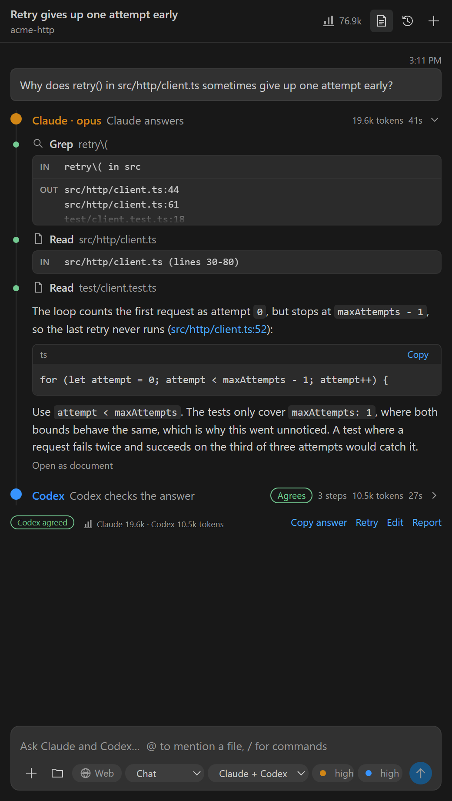
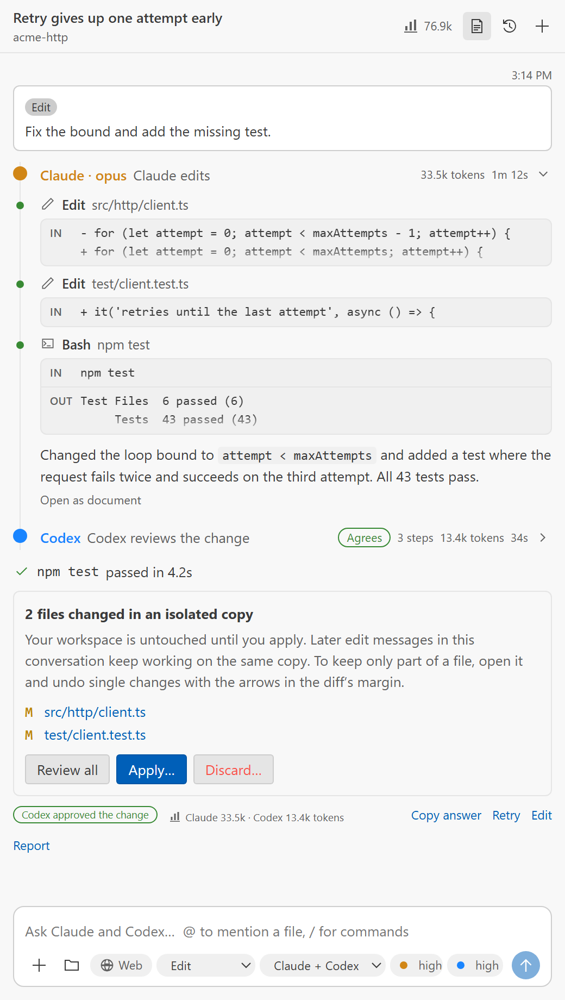
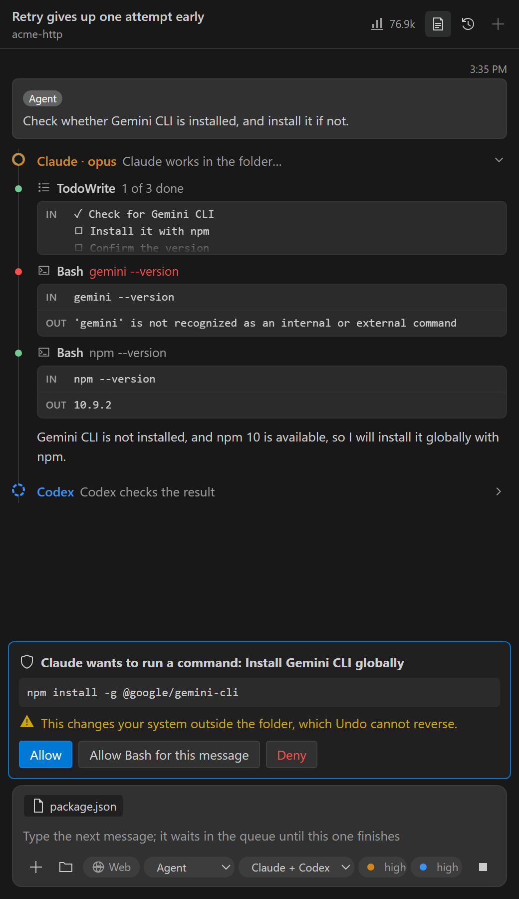
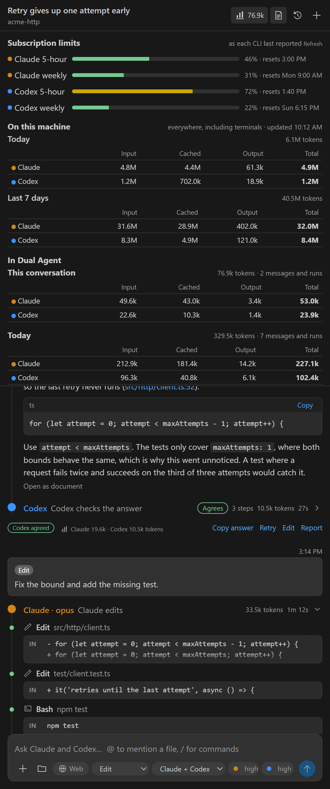
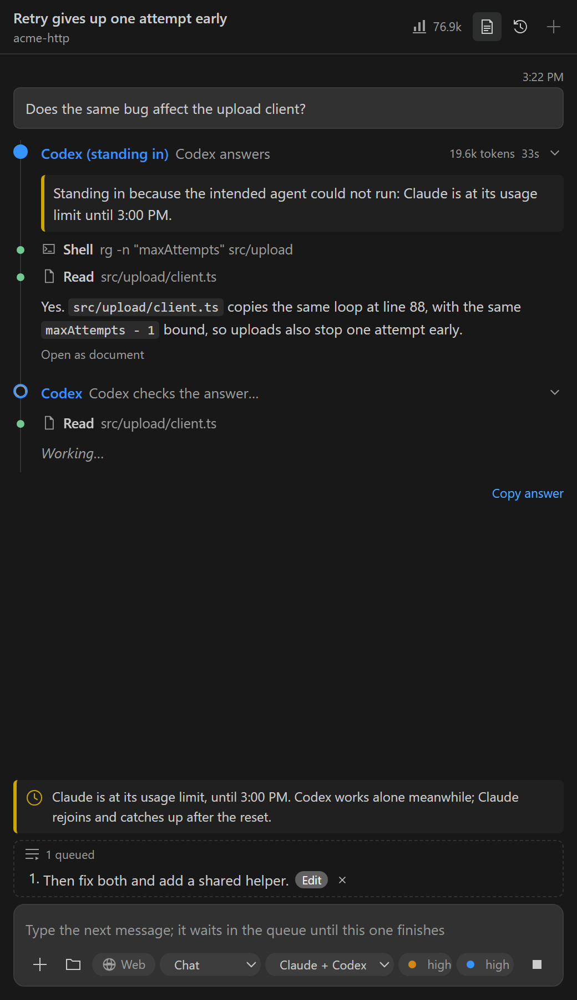

# Dual Agent: Claude + Codex

**Claude answers. Codex checks the answer.** A chat for VS Code in which two coding agents work as a disciplined pair: one does the work, the other independently verifies it, and you see both. It drives the Claude Code and Codex CLIs you already have, with their own sign-in.

## Why two agents

One agent can sound right and be wrong. Here every answer gets a second opinion before you rely on it:

- **Chat:** Claude answers with read-only tools, then Codex checks the answer against the code. If Codex finds a material problem, Claude revises, and you see both.
- **Research:** Claude searches the web and cites what it read. Codex opens every source to confirm it exists and supports the claim, then looks for work Claude missed or that contradicts it.
- **Edit:** Claude edits an isolated copy of your repository and runs your tests. Codex reviews the diff, and Claude fixes what it finds. Nothing reaches your files until you apply the change.
- **Agent:** Claude works in your folder as it would in a terminal: it runs commands, installs packages, and edits files, asking you before each command. Codex then checks the result.

You choose who works: Codex can lead while Claude checks, or either agent can work alone.

## Quick start

1. Install [Claude Code](https://code.claude.com/docs/en/setup) and the [Codex CLI](https://learn.chatgpt.com/docs/codex/cli). Sign in to both with **Dual Agent: Sign In**, the sign-in icon in the **Agents** view, or `claude auth login` and `codex login` in a terminal.
2. Install this extension, open a folder, and trust it.
3. Press **Ctrl+Alt+D** (**Cmd+Alt+D** on macOS) to open the chat in the secondary side bar.
4. Run **Dual Agent: Check Agent Setup** if anything looks wrong. The **Get started** walkthrough covers the rest.

## Modes

Choose a mode in the composer, or start one message with a slash command such as `/agent` or `/compare`.

| Mode | What happens | Agent calls | Your files |
|---|---|---|---|
| **Chat** | Claude answers → Codex checks → Claude revises only if needed | 2–3 | read-only |
| **Research** | Claude researches with cited sources → Codex verifies every source and searches for what is missing | 2–3 | read-only |
| **Agent** | Claude runs commands, installs, and edits the folder, asking you first → Codex checks the result → Claude finishes if needed | 2–3 | edited directly, after a snapshot |
| **Edit** | Claude edits a copy and runs your checks → Codex reviews the diff → bounded fix rounds | 2–4 | applied by you |
| **Test first** | Codex writes failing tests → Claude makes them pass → Codex reviews both | 3+ | applied by you |
| **Compare** | Claude and Codex answer independently → Claude merges and names where they differed | 3 | read-only |
| **Brainstorm** | Proposal → challenge → synthesis → final challenge → recommendation | 5 | read-only |
| **Implement** | Plan → review → **your approval** → implement → review → fix → final gate → report | 7+ | applied by you |

Follow-up messages continue the conversation. Claude resumes its own session, so it is sent only what is new. Codex starts fresh on every message with a summary, so its checks stay independent.

The **agents** menu in the composer, or `/agents`, chooses who works: **Claude + Codex** (the default), **Codex + Claude** (Codex does the work and Claude checks it), **Claude only**, or **Codex only**. One agent alone costs fewer calls and uses only that agent's limits, but has no independent check, and the message says so.

Say "hi" or ask "what can you do?" and the pair introduces itself in one quick reply, in any mode. It costs one call, and the reply doesn't need a check.

## Agent mode

Agent mode is for tasks that need the real environment: install a tool, run a build, set up a project, fix a failing command.

- **Claude asks first.** Before each command or edit it does not judge read-only, the chat shows what Claude wants to do, the exact command, and warnings for deletions, administrator rights, scripts piped from the internet, system changes, and paths outside the folder. Choose **Allow**, **Allow *tool* for this message**, or **Deny**. While the chat is hidden, a dialog asks instead.
- **Codex stays in its sandbox.** Codex cannot ask, so when it leads it works in its own sandbox, which writes only in the folder and can reach the network to install packages (`dualAgent.codex.agentNetwork` turns that off).
- **A snapshot first.** Dual Agent snapshots the folder before the agent starts. **Keep** or **Undo** the file changes from the changes card. Installed software and other effects outside the folder cannot be undone.

## Folders without Git

Edit, Test first, and Implement also work in a folder that is not a Git repository. Dual Agent records the folder's files in a snapshot in its private storage, leaving out `node_modules`, virtual environments, build output, and files whose names suggest secrets. The agents then edit the folder itself, and reviewers see the changes since the snapshot. **Keep** deletes the snapshot; **Undo** puts every changed file back and deletes the files the agents created. A Git repository with a commit still gets an isolated copy.

## Features

- **A chat like Claude Code's.** Streamed answers, a timeline of every tool call with its input and output, Claude's checklist and thinking as steps, Codex's verdict as a badge, Markdown with code blocks you can copy, and file references that open at the right line.
- **Slash commands.** Type `/` for the list: a mode for one message, `/agents`, `/model`, `/effort`, `/web`, `/new`, `/history`, `/export`, `/usage`, `/brief`, and `/help`.
- **From the editor.** The open file, your selection, and its problems go with the next message, shown as a chip you can turn off. **Fix with Dual Agent** and **Explain with Dual Agent** appear as quick fixes on problems, and **Ask Dual Agent About This** in the editor's context menu (**Ctrl+Alt+Shift+D**). Reviewers' findings with a file and line appear as problems in the editor. None of these sends anything by itself; they fill the message box.
- **Attachments.** Paste, drop, or pick images, PDFs, ZIP archives, Word, Excel, and PowerPoint files, notebooks, any text or code, or a whole folder. Type `@` to mention a workspace file.
- **Models and effort per agent.** Pick each agent's model and reasoning effort from the composer, or leave them on the CLI default. The Codex list comes from your installed CLI.
- **Web access when you want it.** Research and Agent mode use the web. The **Web** toggle enables it for one message in any other mode.
- **Reviews that mean something.** A finding of medium severity or higher makes Claude revise. Low-severity notes are shown without another call. A failing test blocks the gate.
- **When the agents disagree.** After a revision, **See what changed** shows the first answer against the revision, with **Keep the revision**, **Prefer the first answer**, and **Check again**. Optionally, Gemini CLI rules on each disputed finding first.
- **Research you can reuse.** A research-gap matrix, a claim-by-claim check with DOI and retraction checks, sources exported as BibTeX or RIS, and a **CSV** button on every table.
- **Isolated edits.** Edits happen in a Git worktree in private storage. Review them in VS Code's multi-file diff editor, then apply or discard them all at once or file by file (checked with `git apply --check`; nothing is staged or committed). After applying, Source Control gets a suggested commit message.
- **Run suggested commands.** Shell code blocks have **Run**, for one-line commands, run without a shell after you confirm, with the output attached to your next message, and **Terminal**, which pastes a one-line command without pressing Enter.
- **A project brief.** Write once what both agents should know about the project; it goes with every message and is stored privately, not in the repository.
- **Token usage and limits you can see.** Every stage and message shows its tokens. The chart button shows totals for the conversation, today, the last 7 days, and all time, how much of each subscription's five-hour and weekly limits is used, and your use of both CLIs anywhere on this machine, including terminals, read from their own logs.

  

- **Lean prompts.** Chat and Research get a workspace summary and read only the files they need. Each reviewer sees the steps the previous agent took, so it checks specific claims instead of exploring again.
- **Queue messages.** Type the next message while one runs; it waits in a queue you can edit, and runs when the current one finishes.
- **Retry or edit any message.** Run an earlier message again, or change it first. The messages after it are removed, and their file changes are undone from a checkpoint.
- **Resume anything.** A failed, cancelled, or interrupted message continues from its first unfinished stage.
- **Search and export.** Search earlier conversations, and export one as Markdown.
- **Sign in from VS Code.** **Dual Agent: Sign In** runs Claude Code's, Codex's, or Gemini CLI's own sign-in in a terminal: in the browser, with a device code, or with an API key that goes straight to the CLI. The **Agents** view shows whether each CLI is signed in and with which plan, the chat says when an agent the next message needs is signed out, and a message that failed because of the sign-in gets a **Sign in** button. **Dual Agent: Sign Out** signs out of a CLI.

## When a usage limit is hit

Work keeps going when one subscription runs out:

1. **One agent at its limit.** The other agent does its stages too, marked as standing in, so the conversation continues. The extension reads when the limit resets from the provider's message, and hands over before a call fails when a usage window is 98% used.
2. **The limit resets.** The agent rejoins on its own. Claude is given the messages it missed, so it picks up where the conversation is.
3. **Both agents at their limits.** The message pauses with the reset time, then continues by itself a minute after the first reset, from the stage where it stopped. Queued messages follow. **Continue now** and **Do not continue** are on the card.

A lost connection works the same way: while the machine is offline the message waits, and it continues where it stopped once the connection is back. If only one provider is down, the other agent covers its stages.

A stand-in that checks its own answer is not an independent check, and the timeline says so. Turn off `dualAgent.fallbackOnQuota` to wait for the limited agent instead, or `dualAgent.limits.autoContinue` to continue paused work only by hand.

## Privacy and security

This extension runs local programs that can read your code, so its safety rules are enforced in code, not in prompts.

- **Your sign-in stays with the CLIs.** The extension never reads credential files. By default it removes API keys and alternate endpoints from the agents' environment, so you are not billed per token by accident.
- **Only an allowlisted environment** reaches the agents: `PATH`, home and temp folders, locale, and proxy settings. Tokens such as `GITHUB_TOKEN` and cloud credentials are withheld.
- **Secrets are masked in prompts.** API keys, tokens, and private keys (AWS, GitHub, OpenAI, Anthropic, Google, Slack, Stripe, npm, Azure, JWTs, PEM keys) in the diffs, files, attachments, history, and check output the extension sends are replaced with `[redacted …]`. The same applies to the output log and exported files. Files whose names suggest secrets, such as `.env`, are never read into prompts.
- **Read-only means read-only.** Reviewers and Chat answers get only file-reading tools: no shell, no writes, no web unless you turn it on.
- **Agent mode asks you.** Claude runs a command or edit it does not judge read-only only after you allow it, through a private, token-protected channel to the chat. Codex in Agent mode stays inside its sandbox.
- **A repository cannot reconfigure the extension.** Every setting is machine-scoped. Executables are never taken from the workspace, Git runs with hooks disabled, and Claude loads only your user settings and no MCP servers, unless you allow your own with `dualAgent.claude.userMcpServers`.
- **Edits need your consent** on every message, and reach your files only when you apply them, or, in Agent mode and folders without Git, after a snapshot you can undo.
- **The chat page is locked down.** A strict Content-Security-Policy with Trusted Types: nothing loads from the network, only the bundled script runs, and agent text never becomes HTML.
- **No telemetry.** Conversations, attachments, and run records stay in VS Code's private storage. **Dual Agent: Delete All History** removes them for the workspace. The extension's only network activity of its own is a connection check after a network error, which sends no data.

What each agent receives is governed by Anthropic's and OpenAI's own account terms, and Google's for the optional Gemini referee. See the [threat model](docs/SECURITY.md) for every control and its residual risk.

## Requirements

- Desktop VS Code 1.105 or newer. Web and virtual workspaces are not supported, because the agents need a local file system.
- Claude Code, recent enough for `--tools`, `--effort`, and `--include-partial-messages` (verified with 2.1.312), and the Codex CLI, both signed in.
- Git on `PATH` for every mode that edits files. A repository with a commit gets an isolated copy; any other folder is edited directly after a snapshot.
- Optional: [Gemini CLI](https://github.com/google-gemini/gemini-cli) as referee (`npm install -g @google/gemini-cli`, then run `gemini` once to sign in).

On Windows with a restrictive PowerShell execution policy, the extension still works: it starts the CLIs directly, not through PowerShell.

## Settings

All settings are in your **user** settings; a repository's `.vscode/settings.json` cannot change them.

| Setting | Default | Purpose |
|---|---:|---|
| `dualAgent.verification.commands` | empty | Your checks, run after every edit, such as `[["npm", "test"]]` |
| `dualAgent.isolation.setupCommands` | empty | Run once in a new worktree, such as `[["npm", "ci"]]` |
| `dualAgent.claude.model`, `dualAgent.codex.model` | empty | Default models; the composer can override them per message |
| `dualAgent.claude.effort`, `dualAgent.codex.effort` | empty | Default reasoning effort |
| `dualAgent.billingMode` | `subscription` | `environment` passes API keys through, which may incur API charges |
| `dualAgent.privacy.redactSecrets` | `true` | Mask credentials in prompts, logs, and exported files |
| `dualAgent.fallbackOnQuota` | `true` | Let the other agent work alone while one is at its usage limit |
| `dualAgent.limits.autoContinue` | `true` | Continue paused work once the usage limits reset |
| `dualAgent.workflow.maxFixRounds` | `1` | Fix rounds after a failing final gate (0–3) |
| `dualAgent.workflow.approvePlan` | `true` | Pause Implement runs for your approval before any edit |
| `dualAgent.isolation.mode` | `worktree` | `none` edits the workspace directly |
| `dualAgent.claude.allowedTools` | empty | Extra Claude permission rules for editing and Agent-mode stages, such as `Bash(npm run lint:*)` |
| `dualAgent.codex.agentNetwork` | `true` | Let Codex's sandbox reach the network in Agent mode |
| `dualAgent.claude.userMcpServers` | `false` | Let Claude load the MCP servers in your own Claude configuration |
| `dualAgent.chat.includeEditorContext` | `true` | Send the open file, selection, and problems with new messages |
| `dualAgent.findings.showInEditor` | `true` | Show reviewers' findings as problems in the editor |
| `dualAgent.chat.sound` | `true` | Chime when a message that took longer than 15 seconds finishes |
| `dualAgent.gemini.enabled` | `false` | Let Gemini CLI rule on a failed check's findings before the revision |
| `dualAgent.usage.readLocalLogs` | `true` | Count usage and limits from the CLIs' own logs, including terminals and other editors |
| `dualAgent.environment.passthrough` | empty | Extra environment variable names for the agents |
| `dualAgent.timeoutMinutes` | `30` | Maximum duration of one stage |

Commands are argument lists, run without a shell, and resolved from `PATH`: `["npx", "vitest", "run"]`, not `"npx vitest run"`. They run code the agents changed, with your permissions, so they are listed in the consent card. The [operations guide](docs/OPERATIONS.md) covers the other settings and troubleshooting.

## Usage and limits

Token counts come from what each CLI reports. The limits meter shows what the CLIs last reported about each subscription's usage windows: Claude reports them during a call, and Codex writes them to its own session log. **Refresh** in the meter asks for the current numbers with one tiny call to each agent (Claude on Haiku, Codex at low effort), which uses a little of each subscription; a window whose reset time has passed shows as empty. With `dualAgent.usage.readLocalLogs` on (the default), the extension also reads both CLIs' logs for token counts and limits from your other sessions; it keeps only those numbers, never the conversations. Checking every answer costs more than one agent alone: expect two to three agent calls per chat message. Fix rounds add calls when a check fails; set `dualAgent.workflow.maxFixRounds` to `0` to turn them off. A retried message starts fresh sessions, so it costs more than a follow-up.

## Known limitations

- The verdict is model output. It decides revisions and the run's label, never permissions, and a reviewer can be wrong.
- Claude's tool limits are enforced by Claude Code itself, not an operating-system sandbox. Your user-level Claude hooks still apply.
- An Agent message does not continue an Edit message's changes waiting in an isolated copy, or the other way round. The chat asks whether to apply, discard, keep, or undo them first, then sends the message.
- Agent mode runs on your machine with your permissions. Claude Code decides which commands are read-only and runs those without asking, and allowing a tool for a message allows it for the rest of that message.
- Undo in a folder edited directly leaves the folders the snapshot skips, such as `node_modules`, as they are, and folders with more than 20,000 other files cannot be snapshotted.
- Codex reads the text the extension extracts from PDFs and Office files. Scanned PDFs without a text layer give Codex no text, though Claude still reads the pages.
- Attachments: 25 MB per file, 100 MB and 20 files per message.
- Worktrees do not contain ignored files such as `node_modules`; use `dualAgent.isolation.setupCommands` to install dependencies.
- CLI event formats evolve. Unknown events are tolerated, but a provider change can need an update.

## Learn more

- [Workflows and stage contracts](docs/WORKFLOWS.md)
- [Security and threat model](docs/SECURITY.md)
- [Operations and troubleshooting](docs/OPERATIONS.md)
- [Architecture](docs/ARCHITECTURE.md) and [decisions](docs/adr/README.md)
- [Development, testing, and releasing](docs/DEVELOPMENT.md)
- [Changelog](CHANGELOG.md) · [Project status](PROJECT_STATUS.md) · [Contributing](CONTRIBUTING.md) · [Security policy](SECURITY.md)

To build from source: `npm ci`, then `npm run package`, then install the `.vsix` with **Extensions: Install from VSIX…**.

## Disclaimer

This is an independent project, not affiliated with or endorsed by Anthropic, OpenAI, or Google. Claude and Claude Code are trademarks of Anthropic. Codex is a trademark of OpenAI. Gemini is a trademark of Google. You need your own accounts, and their terms apply to everything the agents receive.

## License

MIT. See [LICENSE](LICENSE).
